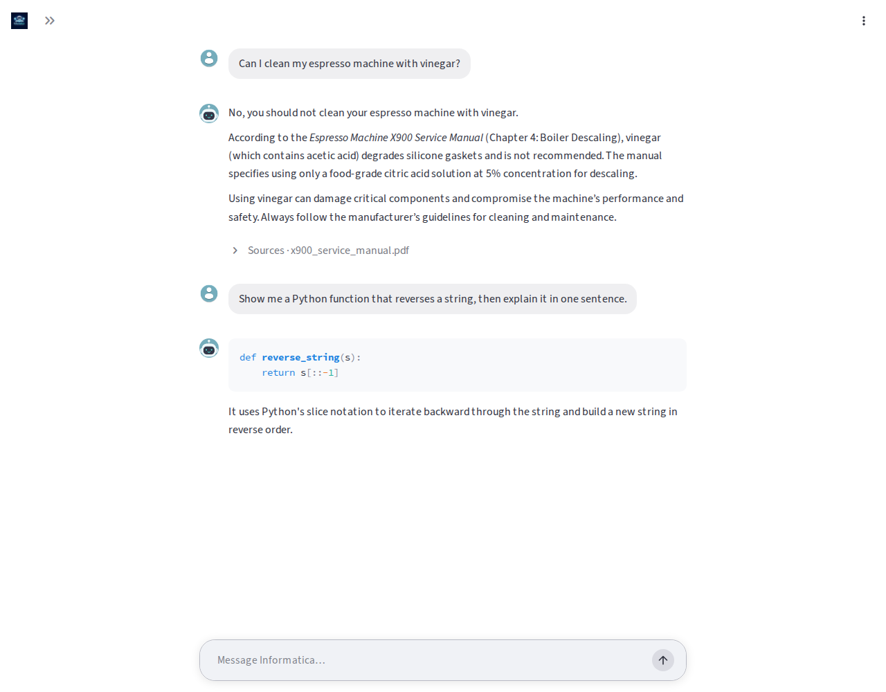

# Informatica



A self-hosted chat assistant that runs on a small home Kubernetes (k3s) cluster.
It started as a "talk to your PDFs" project and grew into a general-purpose
chatbot that *also* knows about the documents you've given it: ask it to write a
shell script and it just answers, ask it about your espresso machine manual and
it pulls in the relevant parts of the manual.

Everything runs on local hardware. No data leaves the house.

## Architecture

```
 Browser ── Streamlit app ──┬── Ollama (chat model)      ← always-on GPU node
                            ├── Ollama (bigger model)    ← optional, when available
                            ├── Ollama (embedding model)
                            ├── Weaviate (vector store)
                            └── Cassandra (users, access requests, saved chats)
```

- **UI:** Streamlit, with answers streamed token by token.
- **Inference:** Ollama, called through LangChain.
- **Documents:** Weaviate stores the document chunks and their embeddings.
- **Users and chats:** Cassandra holds accounts, their access status and
  each user's saved chats.

### Chat first, documents second

Every message goes to the model as a normal conversation (system prompt, recent
turns and the new question) in a single call.

Documents are only added when they are relevant. The question is embedded and
compared with the user's library. Only chunks that are close enough (by cosine
distance) are passed to the model, together with the file they came from. An
off-topic question gets no document context and simply gets a normal answer. A
sidebar switch can force document use to **Always** or **Never** when the
automatic choice guesses wrong.

> Implementation note: retrieval queries Weaviate directly for vector distances
> instead of using LangChain's `similarity_search_with_score()`. That method runs
> a hybrid query whose scores are normalised per result set, so they can't be
> used as a relevance threshold.

### Chat history and long chats

Each user keeps their pinned chats plus their 5 most recently used others,
listed in the sidebar to reopen, pin or delete. Users only see their own
chats, and blocking a user deletes theirs.

The chat model runs on a small GPU that reads prompts slowly, so long chats
are built around llama.cpp's prompt cache, which only helps when a prompt
continues the previous one exactly:

- The system prompt never changes. Retrieved excerpts go into the turn they
  were found for and stay in the history.
- Only a window of the chat is sent. It grows at the end until the prompt
  passes ~12k tokens (Ollama's real count), then the oldest turns are cut in
  one go down to ~6k. That costs one full re-read every few thousand tokens
  instead of one every turn.
- A chat idle for 15 minutes gets a summary from a background thread. The
  request is the chat's last prompt plus "summarise this", so it is usually
  served from the cache. The summary goes in front of the window after a cut,
  and a reopened chat starts from the summary plus the last 2 exchanges.

### Ingesting documents

PDF, Word (.docx), text and Markdown (.md) files can be dropped into the message box (or
uploaded from the sidebar). When the message is sent they are converted to
text, split into overlapping chunks, embedded and stored in Weaviate; a file
that can't be read gets an error notification. Each chunk is tagged with its
file name and its owner, so a document can be deleted or replaced as a unit
and every user only sees their own library. The message a file was attached
to always draws on that file; later messages use the whole library as usual.

### Two backends

The app can use two Ollama servers: a small always-on one and an optional,
much faster one on a machine that isn't always running. The bigger backend is
used only when it is up and already has its model loaded. If it disappears in
the middle of an answer, the answer restarts on the small backend. Each answer
shows which model and machine produced it. Embeddings always use the always-on
server, so stored vectors stay comparable.

### Access control

Sign-in is with Google. Anyone can sign in, but only approved accounts can use
the app; nothing reaches the models or the document store before that check.

- A first sign-in creates an access request, and the admin gets an email.
- The admin approves, blocks or revokes accounts from an in-app page. Changes
  take effect immediately.
- If the user database is unreachable, everyone except the admin is kept out.

## Running it locally

`docker-compose.yml` brings up the whole stack (Ollama with GPU, Weaviate and
the app, built from the same Dockerfile used in the cluster):

```bash
docker compose up -d ollama weaviate    # backends
docker compose run --rm model-init      # pull the models (once)
docker compose up app                   # http://localhost:8501
```

GPU access needs the native Docker daemon with the NVIDIA runtime. Remove the
`runtime: nvidia` line from the ollama service to run on CPU instead.

To run just the Streamlit app against backends already on localhost, use
`./run.sh`.

For sign-in, copy `.streamlit/secrets.toml.example` to
`.streamlit/secrets.toml` and fill in your own Google OAuth client. In the
container, `write_secrets.py` generates that file from environment variables.

## Configuration

All settings live in `config.py` and can be overridden with environment
variables: models, Ollama and Weaviate endpoints, context size, retrieval
settings, the admin account and email notifications.

`tools/calibrate_retrieval.py` helps choose the distance threshold for automatic
document use. It indexes a sample manual and reports the distances for on-topic
and off-topic questions:

```bash
docker compose exec app python tools/calibrate_retrieval.py
```

## Tests

`pytest` runs the unit tests. Setting `INFORMATICA_IT=1` together with
`CASSANDRA_HOSTS` and `WEAVIATE_URL` also runs the integration tests against
real services.

## See it in action

The app is available [here](https://informatica.lucianmusat.nl/) (Google sign-in,
access on request). It's self-hosted, so it might not always be up.

## TODO

 - [X] Display LLM answer while it's being generated
 - [X] Work as a general assistant, not only a document search box
 - [X] Add authentication (I don't want my server to be spammed by randos or bots)
 - [X] Add multi-tenancy (each user only sees their own documents)
 - [X] Use a bigger model on a second GPU when it's available
 - [ ] Prefix embeddings with `search_query:` / `search_document:` as nomic-embed-text
       expects. Needs a full re-index of existing documents, so it's a breaking change
 - [X] Support more than PDFs (Word and text files, dropped into the chat)
